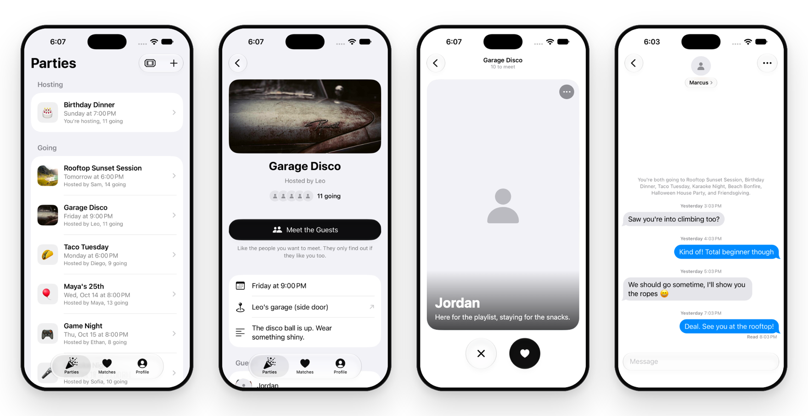

<p align="center">
  <picture>
    <source media="(prefers-color-scheme: dark)" srcset=".github/assets/header-dark.png">
    
  </picture>
</p>

<p align="center">
  
  
  
  
  
</p>

<p align="center">
  You got the invite. But who else is going?<br>
  <b>partymate</b> shows you the guest list of parties you're invited to, lets you quietly like the people you want to meet, and opens a chat when it's mutual, so you can say hi before you arrive.
</p>

<p align="center">
  <a href=".github/assets/partymate-promo.mp4">
    
  </a>
  <br>
  <sub>Preview of the promo video. <a href=".github/assets/partymate-promo.mp4">Watch the full video</a> (MP4, 25 s).</sub>
</p>

<p align="center">
  <picture>
    <source media="(prefers-color-scheme: dark)" srcset=".github/assets/screens-dark.png">
    
  </picture>
</p>

<p align="center"><sub>Left to right: your parties, a party and who's going, meeting the guests, and a chat with a match.<br>People are shown as mock profiles, without photos.</sub></p>

---

## Features

- **Invite-only parties.** No feed and no search. You only ever see parties you host or were invited to, joined with a six-character invite code or link.
- **See who's going.** A party page shows how many people said yes and a few of their faces. Accept the invite to see the full guest list and meet them.
- **Meet the guests.** Swipe through everyone going. Likes are private: people only find out if they like you back.
- **Matches with context.** Matches are grouped by the party you met at, with a note when you're both going to other parties too.
- **Chat.** Real-time messages with delivered and read receipts, a typing indicator, and an iMessage-style layout.
- **For hosts.** Create and edit parties with an emoji or photo cover, share the invite, see who hasn't replied, and remove guests.
- **Safety built in.** Block or report anyone from their card or chat. Full profiles only open once you match, and Instagram handles are only shown to matches.
- **Native iOS 26 design.** System components and Liquid Glass throughout, in black, white, and grey, so people's photos bring the color. Light and dark mode.

## How it works

1. A host creates a party and shares the invite code or link.
2. Guests join with the code and accept the invite.
3. Everyone going can open **Meet the Guests** and like the people they want to meet.
4. When two people like each other, it's a match. They see which parties they're both going to and can start chatting.
5. Leaving a party removes your likes and matches from it.

## Privacy by design

| | Who can see it |
|---|---|
| A party and its details | The host and invited guests |
| Your profile | Only people going to the same party as you |
| Your full profile, from the guest list | Only people you've matched with |
| Your Instagram | Only your matches |
| Your likes | Nobody, unless they're mutual |
| Messages | You and your match |

Rules are enforced in the database with Postgres row-level security, not just in the app. People can delete their account, and everything they created, from the Profile tab.

## Tech stack

| Layer | Technology |
|---|---|
| App | Swift, SwiftUI, Observation, PhotosUI |
| Design | iOS 26 Liquid Glass, SF Pro, SF Symbols |
| Backend | [Supabase](https://supabase.com): Postgres with row-level security, Auth (email magic link), Storage, Realtime |
| SDK | [supabase-swift](https://github.com/supabase/supabase-swift) 2.x via Swift Package Manager |
| Push | Apple Push Notification service, sent from a Supabase Edge Function |
| Promo video | [Remotion](https://www.remotion.dev) |

## Project structure

```
partymate/
├── partymate/                    # The iOS app
│   ├── MyApp.swift               # App entry point
│   ├── ContentView.swift         # Signed-out, profile setup, and tab routing
│   ├── AppStore.swift            # App state and all Supabase calls
│   ├── Models.swift              # Codable models matching the database
│   ├── Theme.swift               # Shared views, logo mark, date formatting
│   ├── SupabaseConfig.swift      # Connection setup (reads SupabaseSecrets.swift)
│   ├── PushManager.swift         # Notification permission and device token
│   └── Views/                    # Screens: parties, party page, deck, matches, chat, profile
├── supabase/
│   ├── schema.sql                # Tables, functions, triggers, row-level security
│   ├── 02 to 05 *.sql            # Migrations, run in order
│   ├── seed-demo.sql             # Optional demo data for testing
│   └── functions/send-push/      # Edge Function for push notifications
├── docs/                         # Draft privacy policy, terms, App Store listing
├── SupabaseSecrets.example.swift # Template for your Supabase keys (never commit the real file)
├── .githooks/pre-commit          # Blocks commits that contain keys
└── SETUP.md                      # Full setup and publishing guide
```

## Getting started

**Requirements:** a Mac with Xcode 27 (the app targets iOS 26 and later) and a free [Supabase](https://supabase.com) project.

1. **Clone the repo** and turn on the secret-blocking commit hook:
   ```bash
   git clone https://github.com/ommsadul/partymate.git
   cd partymate
   git config core.hooksPath .githooks
   ```
2. **Set up the database.** In the Supabase dashboard, open the SQL Editor and run `supabase/schema.sql`, then `02` to `05` in order.
3. **Add your keys.** Copy the template, then fill in your project URL and anon key from **Project Settings → API**:
   ```bash
   cp SupabaseSecrets.example.swift partymate/SupabaseSecrets.swift
   ```
4. **Allow the sign-in link.** Under **Authentication → URL Configuration**, add `partymate://login-callback` as a redirect URL.
5. **Run it.** Open `partymate.xcodeproj` in Xcode and press ⌘R.

To try the app with realistic content, sign in once, then run `supabase/seed-demo.sql`. It adds parties, guests, likes, and chats for your account. `supabase/remove-demo.sql` removes all of it.

[SETUP.md](SETUP.md) covers the rest: push notifications, invite links that open from iMessage, custom email, and publishing to the App Store.

## Roadmap

- [x] Parties, invites, and RSVPs
- [x] Guest deck, private likes, and matches
- [x] Real-time chat with read receipts
- [x] Block, report, and account deletion
- [x] App icon, privacy manifest, and App Store prep
- [ ] One-time code sign-in (and an App Review account)
- [ ] Push notifications for matches and messages
- [ ] Invite links that open from iMessage
- [ ] Live mode: check in at the party, and the deck closes after it ends
- [ ] Host announcements
- [ ] "Here for" on profiles: friends, dating, or both
- [ ] Plus-ones with host approval

## Contributing

partymate is a personal project in active development. Bug reports and ideas are welcome in [Issues](https://github.com/ommsadul/partymate/issues).

Never commit real keys. Keep them in `partymate/SupabaseSecrets.swift`, which git ignores; the pre-commit hook blocks anything that looks like a secret.

## License

Copyright © 2026 ommsadul. All rights reserved. The source is public to read; no license to reuse it has been granted yet.
